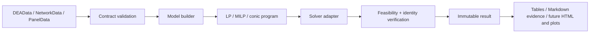

# Architecture

Status: pre-alpha foundation

## Design goals

- One immutable data contract across model families.
- Explicit orientation, returns-to-scale, disposability, and score conventions.
- Optimization backends isolated from statistical model construction.
- Multi-stage networks represented directly rather than flattened.
- Framework-neutral, serializable results with normalized solver status and
  solver identity.
- No silent imputation, clipping, pseudoinverse, or solver fallback.
- Every method independently gated by mathematical and cross-library oracles.

## High-level structure



## Component boundaries

```text
frontierguard
├── data contracts
├── model families
│   ├── radial / additive / directional / SBM
│   ├── super / cross / weight-restricted
│   ├── economic
│   ├── serial and graph-defined network
│   └── productivity
├── solver protocols
│   ├── SciPy-HiGHS (zero-configuration LP default)
│   └── native HiGHS (optional sparse LP diagnostics)
├── immutable results
├── machine-readable method registry
└── CLI diagnostics and audit evidence bundles
```

The default dependency surface remains NumPy, pandas, and SciPy. Optional
backends must not change model conventions or result schemas.

## Current data contracts

`DEAData` stores one non-negative input matrix, output matrix, variable names,
DMU names, and a deterministic fingerprint. `SerialNetworkData` additionally
stores an ordered sequence of link matrices and stage names. `NetworkData`
stores named stages and directed intermediate-flow links, validates that the
graph is acyclic, and fingerprints both values and topology.

All matrices are copied, validated, and made read-only. Missing and non-finite
values fail before optimization. Negative-data models require an explicit
directional/environmental contract and are not silently translated.

## Solver contract

Models produce minimization-form `LinearProgram` objects. A `LinearSolver`
returns a framework-neutral status, primal vector, objective, raw status, and
message. SciPy-HiGHS is the default backend. The optional direct HiGHS adapter
also exposes duals, reduced costs, sparse matrices, and deterministic controls.
Public model results preserve the normalized status and solver identity; raw
adapter codes and messages currently remain backend-layer diagnostics.

Later adapters may add warm starts, sparse batch construction, MILP, quadratic,
or conic programs. A backend is conformant only if it passes the shared golden
and feasibility suite.

## Scale and reliability

Classical DEA solves one optimization problem per evaluated DMU, plus an
optional slack phase. The implementation initially favors transparent dense
matrices; sparse matrices, batching, and parallel execution follow measured
benchmarks. Every parallel or warm-start path must be bitwise deterministic
where the backend permits it and numerically equivalent otherwise.

## Trade-offs

- **Strict contracts over permissive coercion:** users must choose a
  theoretically valid method for zeros, negative data, undesirable outputs, and
  missingness.
- **Multiple explicit classes over one giant function:** prevents incompatible
  conventions from becoming boolean flags.
- **Open-source default solver over maximum raw speed:** HiGHS provides a strong
  installation baseline; optional adapters can optimize large workloads.
- **Feature matrix over marketing claims:** “supported” means oracle-verified,
  not merely present in source.

## Revisit as the system grows

- Sparse LP generation after 10k-DMU benchmarks.
- Promotion of the general DAG network contract after independent published
  branched-network oracles.
- Stable plugin protocols after at least two external solvers or model packs.
- Arrow/Polars and R interoperability after the Python result schema stabilizes.
